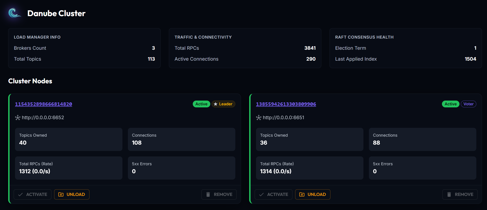
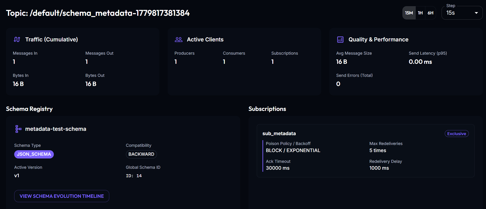

import { Card, CardGrid, Steps } from '@astrojs/starlight/components';

The **Danube Admin UI** is a modern, responsive web dashboard designed for cluster operators and developers. It provides full visibility into cluster state, namespace topology, topic metrics, schema registry configurations, and security policies.

---

## How It Works

The Admin UI is a single-page web application ([danube-admin-ui](https://github.com/danube-messaging/danube-admin-ui), built with React and Material UI) that runs in your browser.

It communicates over REST/HTTP (`/ui/v1/...`) with the **Danube Admin BFF Server**, built directly into the unified `danube` binary (`danube ctl serve --mode ui`). The BFF translates HTTP requests into gRPC calls against your cluster's multiplexed endpoint (default port `6650`) and optionally queries Prometheus for time-series charts.

---

## Guided Tour

Here is a walkthrough of the main pages in the Danube Admin UI.

### Cluster Dashboard
The landing page is your operational command center. It is organized into three main areas:

**Cluster Info Panels**: Three summary cards at the top give you an instant snapshot of the cluster:
* **Load Manager Info**: Active broker count and total topic count across the cluster.
* **Traffic & Connectivity**: Aggregate RPC totals and the number of active client connections.
* **Raft Consensus Health**: The current election term and last applied log index, confirming that the consensus layer is healthy and converging.

**Cluster Nodes**: Each broker is displayed as a card showing its Raft role, status, and live stats. Operational actions like Activate, Unload, Promote, and Remove are available directly from each card.



**Load Balancing & Traffic Distribution**: Shows the cluster's balance health score, per-broker load distribution, and lets you trigger a cluster rebalance with an optional dry-run preview.


### Broker Details
Clicking on a broker card takes you to the broker detail page. Here you can see the full list of topics currently assigned to that broker, along with per-topic stats such as subscription counts and producer/consumer activity.


### Topics
The Topics page lists all topics across the cluster with key metadata at a glance: delivery type,  active producer, subscriptions and consumers.

Clicking on a topic opens its detail page, where you can inspect traffic metrics, active producers and consumers, subscriptions, and the schema associated with the topic.



### Schema Registry
The Schema Registry page provides a browsable view of all registered schemas. You can inspect individual schema definitions, see which topics reference them, and review schema versions.


### Schema Details
Clicking on a schema opens its detail page, where you can inspect the schema definition and review schema versions.


### Namespaces
The Namespaces page lists all active namespaces in the cluster. You can create new namespaces or inspect administrative properties, allowing you to segment your messaging resources by environment, team, or application.

### Security & RBAC
Manage access control policies for your messaging resources. You can configure custom roles with fine-grained permissions (e.g., `Produce`, `Consume`, `Lookup`) and bind them to users or service accounts at cluster, namespace, or topic scopes.

---

## Running the BFF with a Docker Compose Cluster

The unified `docker/docker-compose.yml` boots a 3-broker Raft cluster (`broker1`, `broker2`, `broker3`) from the single `danube` image with **zero mounted YAML config files**, exposing multiplexed data + admin gRPC on ports `6650`, `6651`, and `6652`.

<Steps>
1. **Start the 3-broker cluster**:
   ```bash
   wget https://raw.githubusercontent.com/danube-messaging/danube/main/docker/docker-compose.yml
   docker compose up -d
   ```

2. **Start the Admin BFF server (`danube ctl serve --mode ui`)**:
   Point the BFF at `broker1` on the multiplexed port `6650` (and pass `--cors-allow-origin` for your frontend origin if serving the React UI separately):
   ```bash
   danube ctl serve --mode ui \
     --listen-addr 0.0.0.0:8080 \
     --broker-endpoint http://127.0.0.1:6650
   ```
   This serves the `/ui/v1/...` REST BFF endpoints as well as the `/mcp` Streamable HTTP endpoint on `http://localhost:8080`. See [Administration Overview](/admin/overview/) for the complete BFF route table and Bearer auth environment variables (`DANUBE_HTTP_TOKEN`, `DANUBE_ADMIN_TOKEN`).

3. **Connect the Web UI**:
   Run or deploy the [Danube Admin UI](https://github.com/danube-messaging/danube-admin-ui) frontend configured against the BFF address (`http://localhost:8080`), or test the BFF health directly:
   ```bash
   curl http://localhost:8080/ui/v1/health
   ```

4. **Stop and Clean Up**:
   ```bash
   docker compose down -v
   ```
</Steps>
