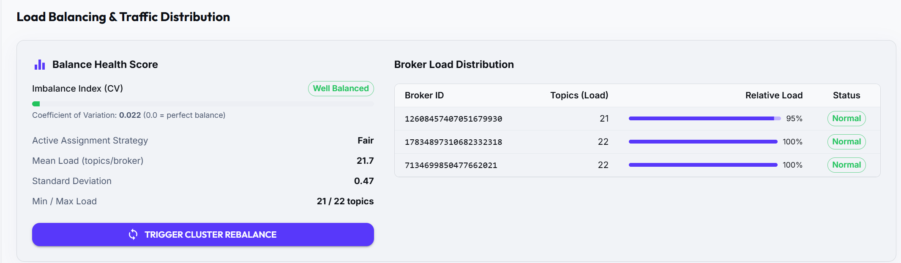
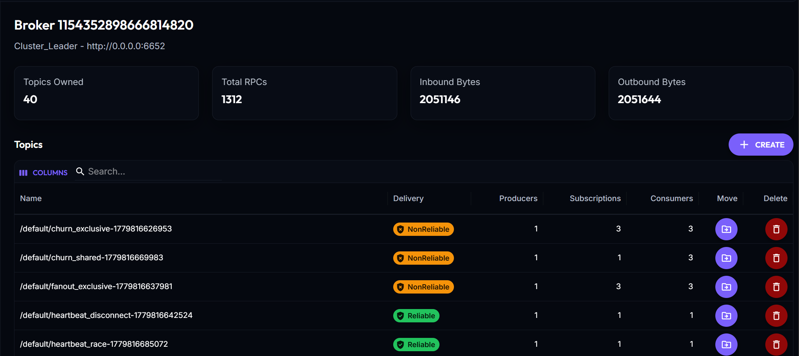
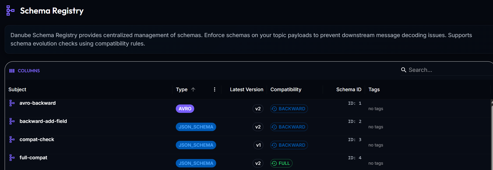
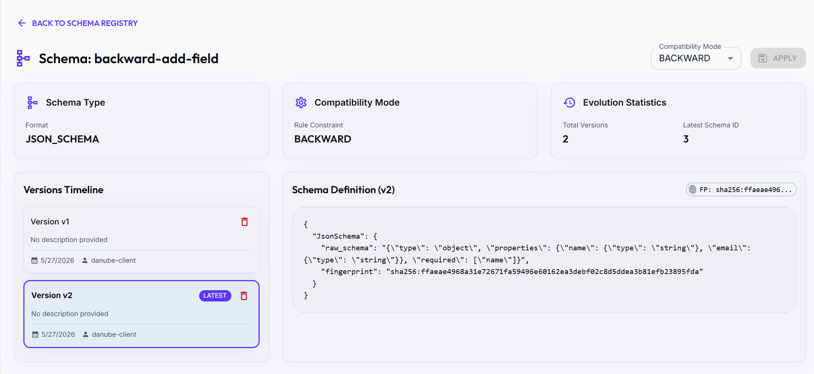

import { Card, CardGrid, LinkCard, Steps, Aside } from '@astrojs/starlight/components';

`danube console` gives your cluster a visual control room. It runs the HTTP backend behind the Danube web console, so you can see broker load, topic traffic, schemas and access rules at a glance and act on them with a click.

```bash
danube console --endpoint http://127.0.0.1:6650
curl http://localhost:8080/ui/v1/health
# {"status":"ok","leader_reachable":true}
```

## How it fits together

The console has two parts:

- **The backend** (`danube console`): an HTTP server built into the `danube` binary. It serves a REST API under `/ui/v1/...` and a streamable HTTP MCP endpoint under `/mcp`. Every request is translated into admin gRPC calls against your broker, and charts are enriched with Prometheus data when it is available.
- **The frontend**: the [Danube Admin UI](https://github.com/danube-messaging/danube-admin-ui), a single-page web app that runs in the browser and talks to the backend over HTTP.

Because the backend is a plain REST API, you can also script against it directly or put your own UI on top.

## Run the console

<Steps>
1. **Start a broker** (skip this if you already have one):
   ```bash
   danube up standalone
   ```

2. **Start the console backend** and point it at the broker:
   ```bash
   danube console --listen 0.0.0.0:8080 --endpoint http://127.0.0.1:6650
   ```

3. **Check that it can reach the cluster leader**:
   ```bash
   curl http://localhost:8080/ui/v1/health
   ```

4. **Open the frontend**: run or deploy the [Danube Admin UI](https://github.com/danube-messaging/danube-admin-ui) configured with the backend address `http://localhost:8080`.
</Steps>

<Aside type="tip">
The console uses the same connection settings as every other client command. If you saved a context with `danube context add ... --use`, plain `danube console` connects to it, TLS and token included.
</Aside>

## Console flags

### Server

- **`--listen <ADDR>`**: HTTP listen address. Default `0.0.0.0:8080`. Env: `DANUBE_CONSOLE_LISTEN`.
- **`--require-auth`**: reject HTTP requests that carry no valid bearer token. Env: `DANUBE_HTTP_REQUIRE_AUTH`.
- **`--http-token <TOKEN>`**: the bearer token the console accepts. Env: `DANUBE_HTTP_TOKEN`.
- **`--cors-allow-origin <ORIGIN>`**: CORS allowed origin.
- **`--cache-ttl-ms <MS>`**: how long dashboard responses are cached. Default `3000`.

### Backend

- **`--prometheus-url <URL>`**: Prometheus used for charts and metrics tools. Default `http://localhost:9090`. Env: `DANUBE_PROMETHEUS_URL`.
- **`--metrics-timeout-ms <MS>`**: Prometheus query timeout. Default `5000`.
- **`--request-timeout-ms <MS>`**: admin API request timeout. Default `5000`.
- **`--config <FILE>`**: MCP configuration file that enables log access tools on `/mcp`. Env: `DANUBE_MCP_CONFIG`. See [AI Admin (MCP)](/admin/mcp/#add-log-access-with-a-config-file).

### Connection

`--endpoint`, `--context`, `--token`, `--tls`, `--tls-ca`, `--tls-cert`, `--tls-key` and `--tls-domain` work exactly as on every other client command. See [client connection flags](/reference/broker-configuration/#client-connection-flags).

<Aside type="tip">
Without `--cors-allow-origin` the console accepts browser requests from any origin. Set it (for example `--cors-allow-origin https://console.example.com`) to allow only your UI's origin.
</Aside>

## Protect the console

The console can change your cluster (unload brokers, delete topics, edit RBAC), so lock it down before exposing it beyond localhost.

```bash
export DANUBE_HTTP_TOKEN="$(openssl rand -hex 32)"
danube console --require-auth --prometheus-url http://prometheus:9090 \
  --endpoint https://broker1:6650 --tls-ca ./ca.pem --token "$ADMIN_JWT"
```

- Requests must send `Authorization: Bearer <token>` (or an `x-api-key: <token>` header).
- Setting `--http-token` alone already enables the check. `--require-auth` without a token rejects every request, so the console fails closed.
- `/ui/v1/health` always stays open, so load balancers can probe it.
- `--token` is a different thing: it is the JWT the console uses when calling the broker.

## A tour of the console

### Cluster dashboard

The landing page shows broker count and total topics, traffic and active connections, and the Raft term and last applied index. Below that, each broker is a card with its Raft role, status and live stats, plus Activate, Unload and Remove actions.


The bottom of the page shows how evenly load is spread and lets you trigger a rebalance, with a dry-run preview first.



### Broker details

Click a broker to see every topic it currently owns, with producers, consumers and subscriptions per topic.



### Topics

The topics page lists every topic in the cluster with its delivery type, producers, subscriptions and consumers. Open a topic for traffic charts, subscriptions and its schema.


### Schema registry

Browse every registered subject, open one to read its definition and walk through its versions.





### Namespaces and security

The namespaces page lists namespaces with their topics and policies. The security pages manage roles and bindings: create a role from permissions such as `Produce`, `Consume` and `Lookup`, then bind it to a user or service account at cluster, namespace or topic scope.

## REST API

All routes live under `/ui/v1`. Topic paths in URLs must be URL-encoded (`/default/orders` becomes `%2Fdefault%2Forders`).

<CardGrid>
  <Card title="Cluster and brokers" icon="setting">
    - `GET /health`
    - `GET /cluster`
    - `POST /cluster/actions`
    - `GET /cluster/balance`
    - `POST /cluster/rebalance`
    - `GET /cluster/raft`
    - `POST /cluster/raft/actions`
    - `GET /brokers/{broker_id}`
  </Card>
  <Card title="Topics and namespaces" icon="list-format">
    - `GET /topics`
    - `GET /topics/{topic}`
    - `GET /topics/{topic}/series?from=&to=&step=`
    - `POST /topics/actions`
    - `GET /namespaces`
  </Card>
  <Card title="Schemas" icon="document">
    - `GET /schemas`
    - `GET /schemas/{subject}`
    - `POST /schemas/actions`
  </Card>
  <Card title="Security" icon="approve-check">
    - `GET /security/roles`
    - `POST /security/roles/actions`
    - `GET /security/bindings`
    - `POST /security/bindings/actions`
  </Card>
</CardGrid>

The same server also exposes MCP at `/mcp`, so remote AI agents can connect to `http://<host>:8080/mcp`.

## Next steps

<CardGrid>
  <LinkCard title="AI Admin (MCP)" href="/admin/mcp/" description="Connect an AI assistant to the /mcp endpoint." />
  <LinkCard title="Cluster operations" href="/admin/cli-cluster/" description="The CLI equivalents of every console action." />
  <LinkCard title="Securing a cluster" href="/security/securing-a-cluster/" description="TLS, JWT and RBAC end to end." />
</CardGrid>
